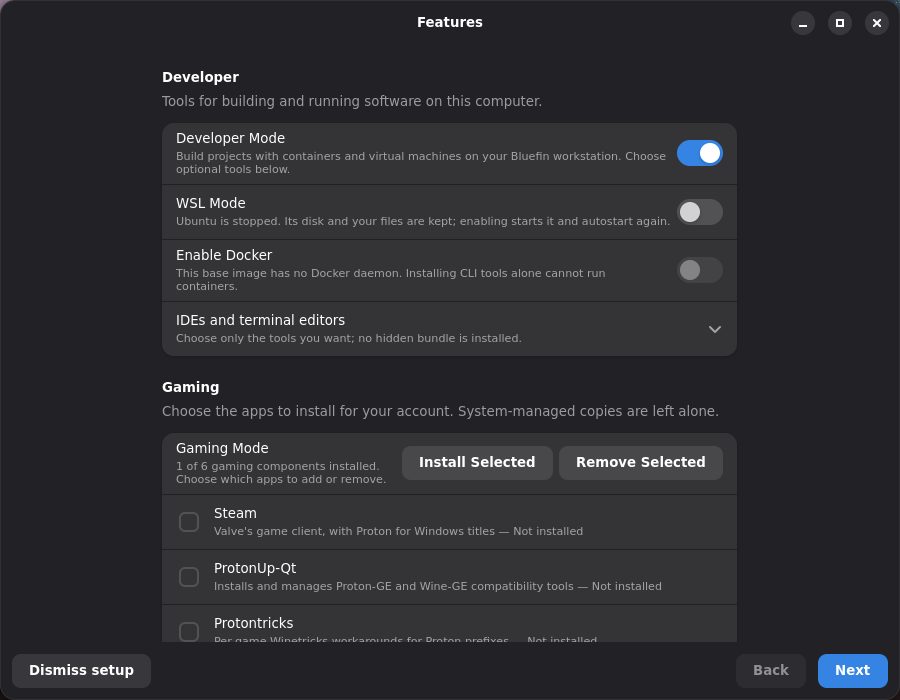
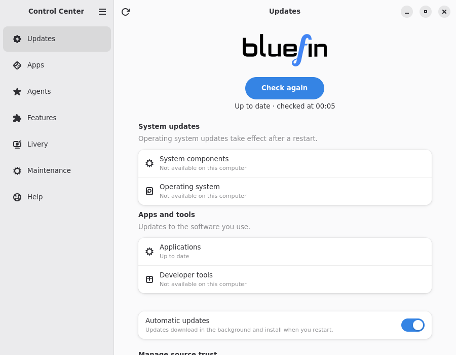
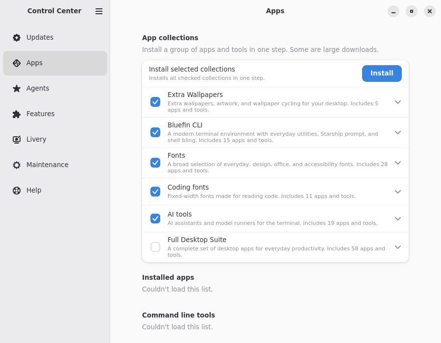
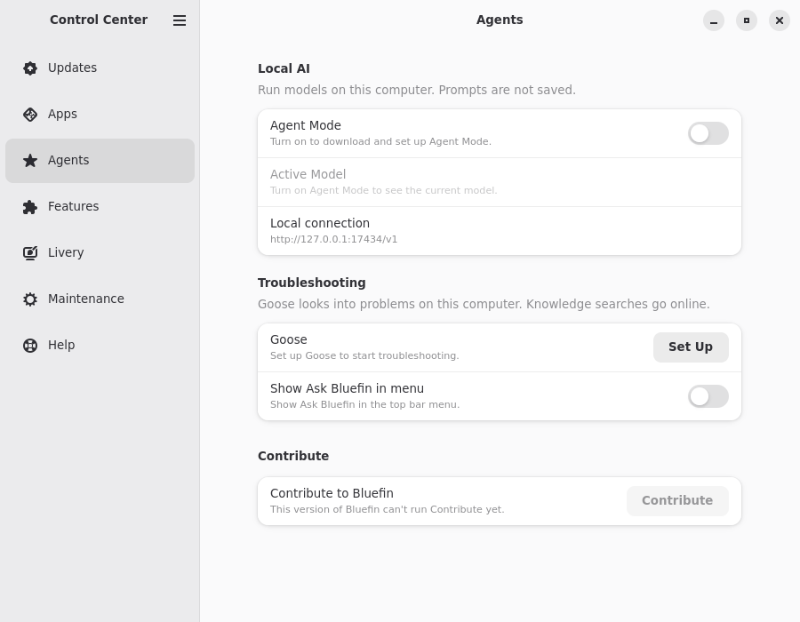
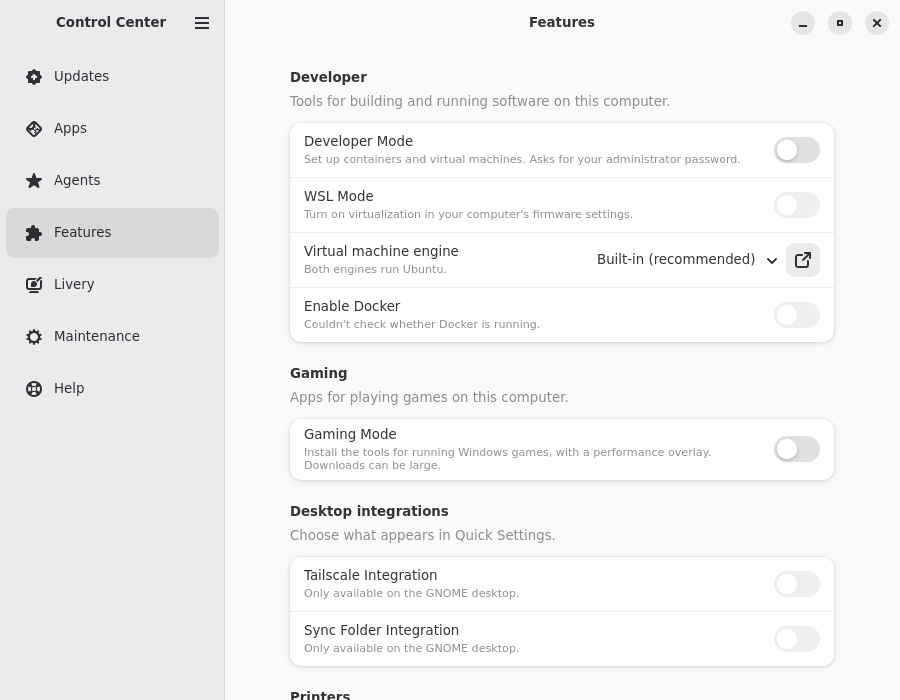
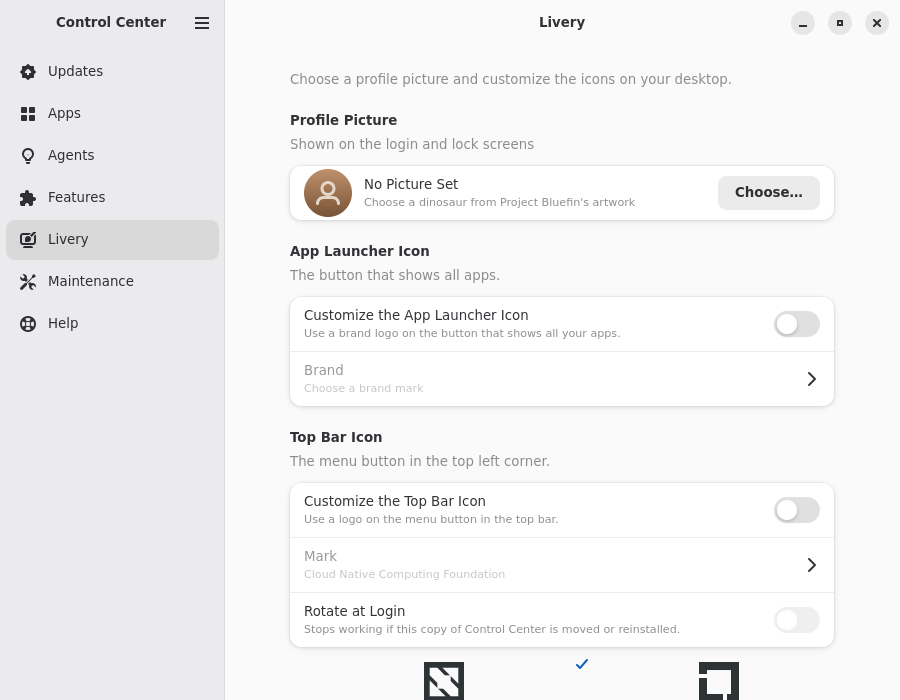
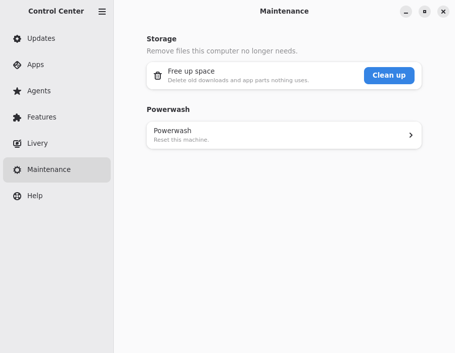
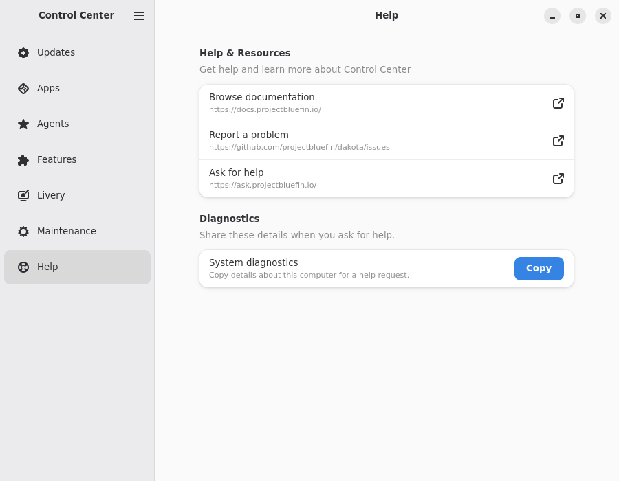

# Control Center walkthrough

The screenshots below come from the real application, not mockups. They are
committed captures, not a live report of this checkout; the isolated Dakota
capture command and release refresh workflow are documented [below](#how-these-are-made).
Screenshots can show optional groups that the shipped profile hides; available
controls also depend on this computer's tools and administrator configuration.

One app for the Bluefin family (Bluefin, Bluefin LTS, Dakota).
Everything here is one control per decision — no strategy pickers, no
schedule choosers, no feature grids.

---

## Setup Assistant



Setup Assistant never opens automatically. Choose **Setup Assistant…** from
the menu, `chairlift --setup`, or its `--first-run` alias to open Welcome, then
walk **Features**, **Apps**, **Agents**, and **Livery**. Welcome presents the
Bluefin wordmark, introduction and Zavala quote. Unavailable pages are skipped;
the ordinary page controls perform every action. **Back** and **Next** only
navigate. The matching conclusion quotes Edith Wharton. **Finish** saves
completion and returns to Control Center; a save failure reports an
error toast. **Dismiss Setup**
(or Escape) records a skip without undoing previous completion.

---

## Updates



The Bluefin wordmark leads the page, with the one action button directly
under it and a single line of status under the button: **Up to date ·
checked at** a time, how many updates are available, or **Restart to finish
updating**. If something went wrong, a second line says what. **System
Updates** groups System Components and Operating System; **Apps and Tools**
groups Applications and Developer Tools. Each row shows its own state, so you
can see which source is holding you up without opening anything. A source
your administrator turned off says **Disabled by administrator**; one this
computer has no software for says **Not available on this computer** instead.
**Preferences** (Ctrl+,) has a switch per source: a source you turn off there
says **Disabled in preferences** as soon as you change it, and a source you
cannot turn on shows its switch off, greyed out, with the same words as its row
here.

One button covers all of them. It reads **Check Again** when nothing is
pending, **Update All** when something is, and **Retry Failed** if a source
didn't finish. A staged system version adds its own **Restart Now** to the
right of the **Operating System** row, so the header offers no button then;
the source that fails does not stop the others. A run long enough that you
wandered off finishes with a desktop notification.
While checking or installing, an animated activity bar takes the button's
place and stays moving even when the underlying tool has no new output. It
does not claim a percentage.

Everything else on the page sits below the sources, each part only where it
applies (not all of it fits in the shot above).

**Automatic Updates** is the one switch for whether this system keeps itself
up to date in the background. It appears only on systems that ship the
unattended-update timer, and it's a choice about the future — updating right
now is the button above.

**Your System** is a compact line saying what's installed now and what's
queued for the next restart; the exact build identifiers sit behind
**Details** for when you need to quote them in a bug report.

On systems that update as a whole, **Operating System** holds
**System Updates**, which downloads the next system version by itself, and
**What's Changing**, which lists exactly what software a pending update will
add, remove, or upgrade once you press **Compare**. **Roll Back** — returning to
the previous version if an update went badly — lives under **Powerwash**, and
only appears where a previous deployment actually exists.

Each other source keeps its own group for when you want to update just one
thing: **Apps** lists the Flatpak updates waiting, and **Developer Tools**
lists the command-line tools you installed with Homebrew, with a button to
check for new versions. If a Homebrew package came from an unofficial source,
**Manage Source Trust** asks you to trust that source before it will keep
updating it, with one row per source that opens to show each program with
its own Trust button, and a Trust Tap button that trusts every program you
installed from that source.

**Advanced** sits last and holds the two choices that replace the operating
system itself, because both land through an update and both need a restart.
The Release Channel switch, **Get Updates Early**, moves between the stable
version and the early one, and **Graphics Driver** switches you to the NVIDIA
driver if your card wants it. Neither offers a change unless there is
actually something to switch to.

There is no separate System page. What this computer *is* — its name, memory,
disk, and hardware — is GNOME Settings' job, and Control Center does not
duplicate it.

---

## Apps



**App Collections** lead the page: curated collections can be selected with
checkboxes and installed in one step using the **Install** button. Expanding a
collection reveals the names and kinds of the apps and tools inside, so you can
read what an install will add before pressing the button. Installs show
stepped progress while they run, using the same controls in the explicit setup
flow. A collection whose apps and tools are all already on the system reads
**(Installed)** when the page loads, not only after an install in the same
session.

**Installed Apps** and **Command-Line Tools** follow: installed casks first,
then explicitly requested formulae (the packages Homebrew manages).
Dependency-only formulae do not crowd the inventory. Removing a package asks
first; formulae also offer pin and unpin actions. There is no Flatpak inventory,
external catalog launcher, or package search here.

Finally, **Backup** contains **Export app list**, which saves a list of your
apps and tools to your home folder (named Brewfile, replacing any file already
there) so you can reinstall them later.
Export shows **Exporting…** and an activity spinner until it finishes, then
becomes available again, including after a failed export.

---

## Agents



**Agent Mode** is one switch that runs AI models on this computer. Its owned
server binds only to loopback, disables peers and prompt history, and does not
offload inference. A client such as Goose can separately use a cloud provider;
check that client's settings before sending sensitive information.
Turning Agent Mode on installs the llmman model server from Homebrew,
downloads the engine that suits your hardware, and starts it on this computer
only. Turning it off stops the server and keeps the software and any models you
downloaded. The row shows an activity spinner throughout setup and shutdown, then
restores the switch if the operation fails.

**Active Model** lets you choose among models downloaded with `llmman`, becoming usable
only when the local server is ready. **Manage Models** opens llmman's own models page so users pull,
remove, and try models there. The connection address is directly selectable, not hidden in Details.

**Troubleshooting** sits below Agent Mode where Homebrew is installed. Its
**Goose** row is the Agent Mode desktop GUI with read-only tools for this
computer's logs, services, and network, plus searches of the Project Bluefin
knowledge base, which go online. While Goose Desktop or linux-mcp-server is
missing, the row offers **Set Up**, which installs them with Homebrew (Goose
Desktop is published for x86_64 computers only). Once they are installed it
asks for Agent Mode, then a model, and then offers **Launch**. Goose runs in a
profile Control Center writes for it on every launch, so your own Goose
configuration is never read or changed, and one session runs at a time. The
desktop shortcut and `chairlift --ask-bluefin` launch Goose Desktop directly
when ready, or open Control Center to the Agents page naming the missing
requirement. **Show Ask Bluefin in Menu** toggles the distribution's shortcut
in GNOME's top panel menu, and reads on only when the menu actually lists it. Apps and terminals opened
after Agent Mode is on receive `OLLAMA_HOST`; already-open ones need restarting.
Everything here runs in your own account, without an administrator password.

**Contribute to Bluefin** runs the Hive contributor appliance in a terminal to
contribute tasks to Project Bluefin. Before launch, preflight verifies that
`xdg-terminal-exec`, `ujust`, the `contribute` recipe, and `podman` are
available, and that a Hive registration file is present. When a requirement is
missing, the row says in plain words what is needed and keeps the action
button unavailable until ready; a missing sign-up also shows **Registration Guide**,
which opens the setup instructions. In dry-run mode, it previews the launch
without opening a terminal.

---

## Features



**Desktop Integrations** offers **Tailscale Integration** and **Sync Folder
Integration** switches for GNOME Quick Settings. Tailscale's initial switch
position is on and Sync Folder's is off; once GNOME answers, the switches show
its actual saved choices. Sync Folder is labelled experimental. A missing
extension or GNOME session leaves its switch off and unavailable and explains
why.
Changing a switch enables or disables that extension for your account; it does
not install software or start Tailscale or Sync Folder services. Preview mode
leaves GNOME preferences unchanged.

**Developer tools** lets you run containers and virtual machines, and use USB
and serial hardware, without being asked for permission each time. It needs
your administrator password, and takes effect after you log out and back in.
Switching it on also installs the Dev Container CLI (`devcontainer`) when
Homebrew is available; if that install fails you are told, and developer access
stays on.
A distribution may also configure it to install the Pulp feed reader and stage
a curated list of developer feeds in your home folder once you switch it on —
both are off by default, and turning Developer tools back off never removes the
reader, the file, or anything you imported from it.
Developer options also offer **WSL Mode** (nsl persistent Linux machines by
default on x86-64 Linux, with Lima Ubuntu LTS as an alternative on amd64 or arm64)
and **Enable Docker**. WSL needs hardware virtualization and access to
`/dev/kvm`; permission grants require a new login. Docker installs its engine
and tools through Homebrew and runs rootlessly for this account, without
administrator access. A ready Docker socket, not installed CLI tools, confirms
success. Turning it off keeps your containers and installed packages. Missing
UID-map tools or an unavailable user session keep the switch visible but locked,
with an explanation; a missing Docker installation can be installed with one click.
Use **Virtual Machine Engine** to choose the built-in engine or Lima;
both run Ubuntu. An external documentation button beside the chooser opens the
engine's documentation. An existing Lima Ubuntu machine is kept as the choice when no
built-in machine exists, rather than creating a second one. Likewise, a Debian
machine the built-in engine made in an earlier release keeps being used, and
the chooser says so, instead of an Ubuntu machine being created beside it.
**Gaming** is a single toggle that installs gaming tools (ProtonPlus,
Protontricks, GOverlay, MangoHud) system-wide for every account on the
computer, which may ask for an administrator password. Turning it off removes
each tool from every scope it is installed in, leaving in place any copy that
came with the system. Partial failures stay visible instead of being reported
as an all-or-nothing success.
**Printers** is one switch per printer driver family — Ghostscript, HP
(HPLIP), and Gutenprint — offering extra drivers for printers that don't work
on their own. Each runs as a small container in your own account and only
this computer can use it: other computers on your network can't print to it
or reach its settings page. When one is running, its row names the local web
page where you add and manage printers. Turning a driver on checks that its
image was signed by its publisher and keeps that exact version. Turn it off
and back on to get a newer checked version; automatic driver updates are not
yet available. Older installations need the same off/on step to gain this
protection. The rows evaluate systemd state,
journal logs, and container images to diagnose and surface actionable failures
— device access permissions, image availability, plugin verification, or
service crashes — rather than displaying a false enabled or running state.
Printing through a real device has not yet been verified against hardware.
**Optional Features** is the distribution's own feature manager; it is hidden
where the distribution ships none. When a computer offers none of these —
no Developer tools, no Gaming, no Printers, no optional features — the page
says **Nothing to Set Up Here** rather than showing an empty screen.

Agent Mode and Troubleshooting have their own **Agents** page.
Developer actions show an activity spinner, and Gaming actions show step
progress while their changes are running; errors are shown immediately rather
than hidden behind an older message.

---

## Livery



Choose your profile picture and the icons shown around your desktop.
Every profile-picture, app launcher icon, top-bar icon, and Files icon choice
has a visual preview. Search results fetch artwork for at most twelve visible
catalog entries; searching the rest does not download the whole catalog.
Rotation changes the real login schedule with its preferences, and a failed
save restores confirmed state.

**Profile Picture** is the picture on your login and lock screens. Pick one of
Project Bluefin's dinosaurs and Control Center shows its picture from the copy
bundled with the app; nothing changes until you press Apply. If the picture
cannot be shown or the change fails, the chooser says so and your old picture
stays put. Where AccountsService is unavailable the picture is saved to your
home folder instead and appears after you log out and back in, and the
confirmation says which of the two happened.

**App Launcher Icon** is your own mark on the Show Applications button on
GNOME. On KDE Plasma, the same chooser updates each configured Kickoff applet;
if no Kickoff applet is present, the group reports unavailable instead of
pretending the setting can be applied. Search all 3,461 brands
[Simple Icons](https://simpleicons.org/) publishes — your project, your
employer, whatever you answer to — and Control Center fetches the one you pick.
You set it once; it never changes on its own, because a personal mark that
rotated would stop being personal. Turning the mark off resets the Kickoff applet
to Plasma's default icon.

On GNOME, **Top Bar Icon** puts a foundation's mark in the top bar:
CNCF, the Linux Foundation, GNOME, freedesktop.org, Apache, Rust, Universal
Blue, Bazzite, Aurora, or the Open Gaming Collective. This section is omitted
on Plasma, which has no corresponding top-bar surface. On a gaming image the
collective's mark is the one you start with, since that is whose work the
image ships — pick any other and it stays picked.
Apache uses the foundation's current official oak-leaf mark, shown in monochrome
like the other symbolic choices.

**Files Icon** marks the Files application on GNOME or Dolphin on KDE Plasma with
the project you actually work on. Every CNCF project that publishes artwork
is in the list — 214 of them, Kubernetes through bootc — so the picker searches
rather than scrolls, and each one arrives as the project's own color icon
straight from
[cncf/artwork](https://github.com/cncf/artwork).

Both **Top Bar Icon** and **Files Icon** can **Rotate at Login**, which moves
one step down the list each time you log in — so you stand somewhere slightly
different every day without ever picking again.

Any section will also take an SVG of your own, which is the way in for
anything not on the list.

Three things worth knowing. The top-bar section needs the Custom Command Menu
GNOME extension; without it the section is not shown at all rather than
offering a control that does nothing. On GNOME, the Files mark is shared
everywhere — the dock, the app grid, the window switcher — because GNOME keeps
one icon per app, not one per place; Plasma's Dolphin is a separate surface.
Only the Files icon is in color: GNOME's top bar and app-grid glyph draw
single-color silhouettes, recolored to match your theme.

On GNOME, turning a section off restores the previous override or resets to
the distribution default. On KDE Plasma, turning App Grid Livery off removes
ChairLift's icon key from Kickoff applets still using it, restoring Plasma's
default; an applet changed to another icon is left alone.

---

## Maintenance



One button. **Free Up Space** deletes old downloads and app parts nothing uses,
and leaves your apps, files, and containers alone. It
tells you how much it reclaimed only when it could measure it. An activity
spinner remains visible while cleanup is running. Below it sit any
**Maintenance Tasks** whoever set up this computer added. **Powerwash**
holds the actions you can't undo (under **Maintenance → Powerwash**): **Roll Back**
returns to the previous version if an update caused problems, **Powerwash**
removes your Flatpak apps and Distrobox containers (everything on the Apps page
stays), and **Factory Reset** reinstalls the operating system, warning first
that its reset method is still experimental.
Those stay hidden normally until turned on or until a rollback exists; the
Powerwash entry's subtitle names only what the detail currently offers, and
when the reset actions are off the detail says so at the top.

---

## Help



**Troubleshooting**, the AI troubleshooting assistant, is on the Agents page.

Three links, each shown only when it is configured: **Browse Documentation**
(the `website` URL), **Report a Problem** (the `issues` URL, where bug reports
go), and **Ask for Help** (the `chat` URL, Ask Bluefin on Bluefin).

A **Diagnostics** group offers a **System Diagnostics** row that copies
details about this computer — OS, image, system version, full build digest,
kernel, desktop, and GPU, without your user name or home folder — to the
clipboard for a help request.
The version and digest come from the same unprivileged status read as the
Updates page's Details row, and are omitted where no deployment is readable.

When the configuration turns on something this computer cannot run — Flatpak
or Homebrew is absent, or the machine is not a native A/B install — **Feature
Availability** appears with one collapsed row, **Why Is Something Missing?**,
that names each such feature and what it needs.

---

## How these are made

```bash
make screenshots
```

Builds the app, runs it inside the Dakota image on a private headless Mutter
Wayland session — the compositor Bluefin runs — and writes one PNG per page to
`docs/screenshots/`. The session's virtual monitor is the window's default
900×700, so each capture is exactly the window. Keys go through Mutter's
RemoteDesktop API and frames through its ScreenCast API. Always `--dry-run`,
so nothing on the capture machine changes. Hardware the runner doesn't have
is stubbed, and `make ci` checks no released binary can read those stubs.

The capture session is not a booted OS-update target, and its Docker session
prerequisites may be unavailable. A dry-run capture never installs or starts
Docker; the separate live Docker integration gate proves that path. Capture
needs podman and Go on the host.

Run it locally when something's appearance changes and you want to preview
before a release. It isn't regenerated per commit, since font and theme
drift would churn the repo — instead, [the release screenshot workflow](../.github/workflows/release-screenshots.yml)
runs after a successful `goreleaser` workflow (or a manual dispatch), builds
from the selected release tag, and opens a `release-screenshots` pull request
against `main` with changed PNGs. The release-completion trigger is
`workflow_run`, not `release: published`. That pull request goes through the merge queue
like any other and still needs one approval.

A pull request that changes the UI can get its own screenshots without a
local podman: a maintainer comments `/screenshots` on it (or runs
[the pull request screenshot workflow](../.github/workflows/pr-screenshots.yml)
by hand with its number). That workflow captures from the pull request's head
commit with `make screenshots` and commits any changed PNGs to its branch;
the push re-runs CI. It runs on request rather than per push for the same
drift reason, and handles branches in this repository only. `make ci` checks
that every page and configurable group has a screenshot and an entry here.

Within Livery, **Wallpapers** appears when Homebrew and the configured external
wallpaper collection are available. Expand **Wallpaper Collections** to inspect
its actual packages. Its subtitle reports Installed, Update Available,
Not Installed or Indeterminate; choose **Install** or **Update** explicitly.
Opening the page never installs anything. A preview restores the action and
keeps the observed status. Other Livery controls remain available when the
collection is absent. Wallpaper packages are managed here rather than in Apps.
